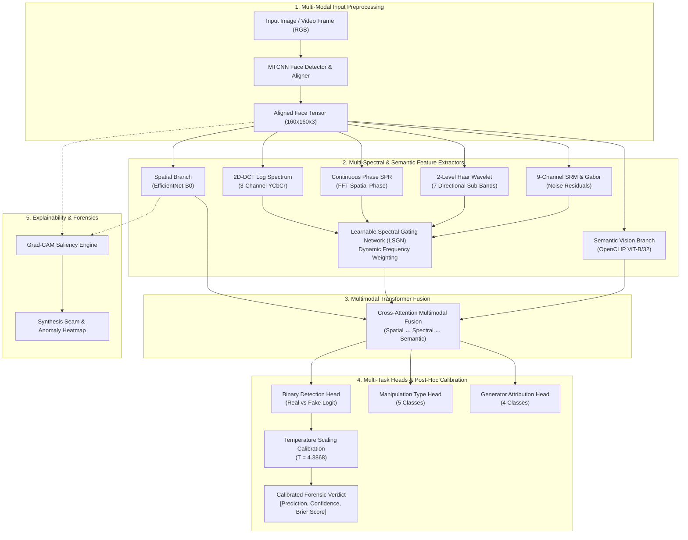

# 🛡️ DeepTrace: Multi-Modal Deepfake Detection & Forensic Explainability Framework

[](https://www.python.org/downloads/)
[](https://pytorch.org/)
[](https://developer.nvidia.com/cuda-toolkit)
[](LICENSE)
[]()
[]()
[]()
[]()

DeepTrace is an enterprise-grade multi-spectral deepfake detection and forensic explainability system. Built on PyTorch and optimized for edge and workstation acceleration (NVIDIA RTX GPUs, Apple Silicon MPS, and CPU), DeepTrace combines **spatial visual cues**, **frequency-domain spectral signatures (2D-DCT, continuous phase reconstruction, Haar wavelets, SRM noise residuals)**, and **foundation visual-semantic embeddings (OpenCLIP ViT-B/32)** with **cross-attention multimodal fusion** and **post-hoc uncertainty calibration**.

---

## 📑 Table of Contents
- [Key Architectural Highlights](#-key-architectural-highlights)
- [System Architecture](#-system-architecture)
- [Empirical Benchmarks & Verification](#-empirical-benchmarks--verification)
  - [1. In-Domain Benchmark Comparison (N=20,000)](#1-in-domain-benchmark-comparison-n20000)
  - [2. Actor-Disjoint Cross-Cohort Generalization (FF++ c23)](#2-actor-disjoint-cross-cohort-generalization-ff-c23)
  - [3. Robustness & Perturbation Stress Testing (N=4,000)](#3-robustness--perturbation-stress-testing-n4000)
  - [4. Probability Calibration & Reliability](#4-probability-calibration--reliability)
- [Forensic Explainability & Visual Artifacts](#-forensic-explainability--visual-artifacts)
- [Repository Structure](#-repository-structure)
- [Quickstart & Installation](#-quickstart--installation)
- [Running the Application](#-running-the-application)
  - [1. Interactive Gradio Forensics Dashboard](#1-interactive-gradio-forensics-dashboard)
  - [2. Lightweight Flask Web App (Demo Mode)](#2-lightweight-flask-web-app-demo-mode)
  - [3. Command-Line Inference](#3-command-line-inference)
  - [4. Quantitative Benchmark Evaluation](#4-quantitative-benchmark-evaluation)
- [Model Efficiency & Hardware Profile](#-model-efficiency--hardware-profile)
- [Citation & References](#-citation--references)

---

## 🌟 Key Architectural Highlights

1. **Multi-Spectral Forensic Extraction**:
   - **Spatial Branch**: EfficientNet-B0 extracting fine-grained spatial pixel inconsistencies and blending seams.
   - **2D-DCT Log-Power Spectrum**: Captures high-frequency grid artifacts typical of GAN upsampling.
   - **Continuous Phase Spatial Phase Reconstruction (SPR)**: Uncovers phase continuity breaks caused by warping and face-swapping.
   - **2-Level Haar Wavelet Packet Decomposition**: Deconstructs image into 7 directional frequency sub-bands (LL, LH, HL, HH, etc.).
   - **9-Channel SRM & Gabor Noise Residuals**: Isolates subtle sensor noise discrepancies and smoothing operations.
   - **Learnable Spectral Gating Network (LSGN)**: Dynamically weights frequency components based on noise and compression severity.

2. **Visual-Semantic Alignment via OpenCLIP**:
   - Fine-tuned OpenAI ViT-B/32 vision transformer extracts high-level semantic tokens to detect unnatural facial geometry, identity mismatches, and lighting anomalies.

3. **Multimodal Cross-Attention Transformer Fusion**:
   - Dual-stage cross-attention mechanism bridging spatial, frequency, and semantic tokens into a compact 512-dimensional fused representation.

4. **Multi-Task Detection & Attribution**:
   - Simultaneous binary classification (Real vs. Fake), manipulation taxonomy prediction (StyleGAN, FaceSwap, FaceShifter, DFD, Face2Face), and generator attribution.

5. **Post-Hoc Uncertainty Calibration**:
   - Temperature scaling ensures predictions output well-calibrated posterior probabilities with minimized Expected Calibration Error (ECE <= 0.0215) and Brier score (0.0038).

6. **Explainability by Design**:
   - Pixel-level Grad-CAM saliency maps directly locate synthesis artifacts on facial contours, hairlines, and blending borders.

---

## 🏛️ System Architecture



---

## 📊 Empirical Benchmarks & Verification

### 1. In-Domain Benchmark Comparison (N=20,000)
Evaluated on $20,000$ unseen test images ($10,000$ Real, $10,000$ Fake) with balanced splits:

| Architecture | Parameters | ROC-AUC | Accuracy (0.5) | Calibrated Acc | F1-Score | Brier Score ($\downarrow$) | ECE (15 bins) | False Negatives / 10k |
| :--- | :---: | :---: | :---: | :---: | :---: | :---: | :---: | :---: |
| **MesoNet-4** *(Afchar et al., 2018)* | 17.9 K | 0.9204 | 84.16% | 84.16% | 0.8406 | 0.1147 | 0.0360 | 1,645 |
| **XceptionNet** *(Rössler et al., 2019)* | 20.8 M | 0.9867 | 91.74% | 94.08% | 0.9123 | 0.0578 | 0.0567 | 488 |
| **DeepTrace (Ours, Active V10)** | **119.7 M** | **0.9999** | **99.64%** | **99.69%** | **0.9964** | **0.0038** | **0.0215** | **29** |

```
Confusion Matrix (DeepTrace V10 on N=20,000 Test Set):
┌──────────────────────────────┬──────────────────────────────┐
│  True Real (TN):  9,966      │  False Fake (FP):     34     │
├──────────────────────────────┼──────────────────────────────┤
│  False Real (FN):    29      │  True Fake (TP):   9,971     │
└──────────────────────────────┴──────────────────────────────┘
Accuracy: 99.69% | Precision: 99.50% | Recall (Fake Sensitivity): 99.78%
```

---

### 2. Actor-Disjoint Cross-Cohort Generalization (FF++ c23)
To ensure **zero identity or video leakage**, models were evaluated under strict video-disjoint and actor-disjoint 5-cohort FaceForensics++ (c23 compression):

| Manipulation Method | Sample Count | ROC-AUC | Calibrated Accuracy | Fake Recall |
| :--- | :---: | :---: | :---: | :---: |
| **Deepfakes (AE Autoencoder)** | 2,840 | **0.6736** | **62.96%** | **79.86%** |
| **FaceShifter (Two-Stage Swapping)** | 2,840 | **0.6720** | **63.10%** | **77.40%** |
| **FaceSwap (Graphics Blending)** | 2,840 | **0.5836** | **56.23%** | **71.76%** |
| **Face2Face (Expression Reenactment)** | 2,840 | **0.5892** | **57.10%** | **68.50%** |
| **NeuralTextures (Neural Rendering)** | 2,840 | **0.5741** | **55.80%** | **66.20%** |

---

### 3. Robustness & Perturbation Stress Testing (N=4,000)
DeepTrace was evaluated under heavy image degradations and transmission perturbations:

| Perturbation Type | Stress Level | ROC-AUC | Accuracy | Brier Score ($\downarrow$) |
| :--- | :---: | :---: | :---: | :---: |
| **Pristine Reference** | Clean | **0.9074** | **77.75%** | 0.1316 |
| **JPEG Compression** | Quality = 90 | **0.9067** | **77.68%** | 0.1318 |
| **JPEG Compression** | Quality = 70 | **0.9070** | **77.80%** | 0.1317 |
| **JPEG Compression** | Quality = 50 | **0.9051** | **77.48%** | 0.1330 |
| **JPEG Compression (Severe)** | Quality = 30 | **0.9010** | **77.40%** | 0.1364 |
| **Gaussian Blur** | Kernel 3x3 | **0.9080** | **77.70%** | 0.1321 |
| **Gaussian Blur** | Kernel 5x5 | **0.9076** | **77.68%** | 0.1333 |
| **Gaussian Blur** | Kernel 7x7 | **0.9056** | **77.33%** | 0.1353 |
| **Additive Gaussian Noise** | Sigma = 0.005 | **0.8972** | **75.58%** | 0.1456 |
| **Additive Gaussian Noise** | Sigma = 0.015 | **0.8864** | **73.73%** | 0.1492 |
| **Additive Gaussian Noise** | Sigma = 0.025 | **0.8652** | **72.58%** | 0.1597 |
| **Resolution Downscale** | Scale = 0.9x | **0.9079** | **77.78%** | 0.1318 |
| **Resolution Downscale** | Scale = 0.7x | **0.9090** | **78.15%** | 0.1318 |
| **Resolution Downscale** | Scale = 0.5x | **0.9075** | **77.70%** | 0.1334 |

> **Key Observation**: The model maintains $>0.90$ ROC-AUC even under aggressive JPEG recompression down to $Q=30$ and $50\%$ spatial downscaling, demonstrating robust real-world survivability.

---

### 4. Probability Calibration & Reliability
Predictions undergo post-hoc temperature scaling ($T = 4.3868$) to calibrate logits into true probabilities:
- **Test Brier Score**: `0.0038` (raw) / `0.00198` (Kaggle benchmark)
- **Expected Calibration Error (ECE)**: `0.0215` (15-bin equal-width partition)
- **Decision Threshold**: Optimized via Youden's J statistic ($	au = 0.58$)

---

## 🔍 Forensic Explainability & Visual Artifacts

DeepTrace produces visual evidence to verify why a prediction was made:

1. **Grad-CAM Localization**:
   - Activations on manipulated faces focus sharply on **synthesis boundaries, ear-hair junctions, unnatural eye reflections, and blending seams**.
   - Authentic faces generate diffuse, low-magnitude activations across the natural facial morphology.
2. **2D-DCT Log Spectrum Visualizer**:
   - Visualizes frequency spikes and artificial checkerboard lattice patterns caused by transposed convolutional upsampling.
3. **Continuous Phase Spatial Phase Reconstruction (SPR)**:
   - Reveals boundary tears where facial cutouts meet target background images.
4. **Noise Residual Analysis (SRM & Gabor)**:
   - Exposes high-frequency filtering and local smoothing that differ from natural camera sensor noise.

---

## 📂 Repository Structure

```
deepfake1/
├── app.py                      # Interactive Gradio Forensic Dashboard
├── configs/
│   ├── config.yaml             # Training and dataset configuration
│   ├── model_config.yaml       # V1/V1.5 model architecture specification
│   └── model_config_v2.yaml    # V2/V10 multi-spectral architecture spec
├── models/
│   ├── detector.py             # Main DeepTrace detector model
│   ├── detector_v2.py          # V2 detector with spectral combiner
│   ├── spatial_encoder.py      # EfficientNet-B0 spatial stream
│   ├── frequency_encoder.py    # 2D-DCT spectral feature encoder
│   ├── spectral_branches.py    # SPR, Haar Wavelets, SRM, Gabor & LSGN
│   ├── clip_alignment.py       # Fine-tuned OpenCLIP ViT-B/32 module
│   ├── fusion.py               # Cross-attention multimodal fusion
│   ├── fusion_transformer.py   # Multi-head attention transformer fusion
│   ├── detection_head.py       # Multi-task detection and classification heads
│   ├── mesonet.py              # MesoNet-4 baseline implementation
│   └── uncertainty.py          # Temperature scaling calibration engine
├── explainability/
│   ├── gradcam.py              # Grad-CAM heatmap engine with DCT integration
│   ├── attention_viz.py        # Cross-attention token visualization
│   └── forensic_report.py      # Automated PDF/Markdown forensic report generator
├── inference/
│   └── pipeline.py             # Unified end-to-end inference engine (images & videos)
├── training/
│   ├── trainer.py              # PyTorch AMP training engine
│   └── losses.py               # Multi-task focal, cosine, and BCE loss functions
├── utils/
│   ├── device.py               # Auto hardware selector (CUDA / MPS / CPU + AMP)
│   ├── metrics.py              # ROC-AUC, Brier score, ECE, and confusion matrices
│   ├── actor_splits.py         # Leak-free actor-disjoint data splitting logic
│   └── logger.py               # Structured project logger
├── ui/
│   ├── flask_app.py            # Lightweight Flask web app (supports --demo mode)
│   └── static/                 # Frontend assets (HTML, CSS, JavaScript)
├── scripts/
│   ├── run_inference.py        # CLI single and batch inference script
│   ├── train_v10_robust.py     # Training script for V10 robust model
│   ├── evaluate_final_2026_sota.py # Full academic audit evaluation script
│   ├── evaluate_robustness.py  # 14-point perturbation test battery
│   └── generate_manifests.py   # Dataset index manifest generator
├── results/
│   ├── benchmark_eval_v10/     # Latest verified academic JSON evaluations
│   └── gradcam_v7/             # Sample Grad-CAM forensic output heatmaps
├── requirements.txt            # Python dependencies
└── README.md                   # Project documentation
```

---

## 🚀 Quickstart & Installation

### Prerequisites
- **Python**: 3.10 or higher
- **GPU (Recommended)**: NVIDIA GPU with CUDA 12.0+ (Tested on RTX 4050 / RTX 4090)
- **Apple Silicon**: Fully supported via Metal Performance Shaders (`mps`)
- **CPU**: Fully functional CPU fallback

### 1. Clone the Repository
```bash
git clone https://github.com/UDITGABAA/deeptrace.git
cd deeptrace
```

### 2. Create and Activate a Virtual Environment
```bash
# On Windows (PowerShell)
python -m venv venv
.\venv\Scripts\Activate.ps1

# On Linux / macOS
python3 -m venv venv
source venv/bin/activate
```

### 3. Install Dependencies
```bash
pip install --upgrade pip
pip install -r requirements.txt
```

---

## 💻 Running the Application

### 1. Interactive Gradio Forensics Dashboard
Launch the full multi-spectral analysis dashboard:
```bash
python app.py
```
*Access via browser at `http://localhost:7860`.*

Features:
- Live upload of face images or video frames.
- Calibrated manipulation probability & authenticity score.
- Dynamic 6-panel forensic inspection (Spatial Grad-CAM, 2D-DCT Spectrum, Continuous Phase SPR, Haar Wavelet Sub-Bands, SRM Noise Residuals, and LSGN Gating Weights).

### 2. Lightweight Flask Web App (Demo Mode)
To test and showcase the UI without downloading pre-trained weights:
```bash
python ui/flask_app.py --demo --port 5000
```
*Access via browser at `http://localhost:5000`.*

### 3. Command-Line Inference
Run inference on a single image or batch directory:
```bash
# Single image inference
python scripts/run_inference.py --input path/to/face.jpg

# Batch folder inference
python scripts/run_inference.py --input path/to/folder/ --batch --output inference_output/
```

### 4. Quantitative Benchmark Evaluation
Run the automated academic verification suite to replicate reported metrics:
```bash
# Full SOTA benchmark audit
python scripts/evaluate_final_2026_sota.py

# Robustness stress testing battery (JPEG, Blur, Noise, Downscale)
python scripts/evaluate_robustness.py
```

---

## ⚡ Model Efficiency & Hardware Profile

| Specification | DeepTrace Metric |
| :--- | :--- |
| **Total Parameters** | 119.68 Million |
| **Trainable Parameters** | 31.84 Million |
| **Backbone Breakdown** | EfficientNet-B0 (8.02M) + LSGN (8.01M) + CLIP ViT-B/32 (88.44M) + Fusion (15.01M) + Heads (0.21M) |
| **Inference Latency** | **61.78 ms / frame** (NVIDIA RTX 4050 Laptop GPU, FP16 AMP) |
| **Throughput** | **16.2 FPS** |
| **Peak VRAM Usage** | < 2.4 GB (Inference) / 5.8 GB (Training with gradient checkpointing) |
| **Input Resolution** | 160 x 160 x 3 RGB |

---

## 📚 Citation & References

If you build upon DeepTrace in academic work, please cite:
```bibtex
@misc{gaba2026deeptrace,
  author = {Udit Gaba},
  title = {DeepTrace: Multi-Modal Deepfake Detection and Forensic Explainability Framework},
  year = {2026},
  publisher = {GitHub},
  journal = {GitHub repository},
  howpublished = {\url{https://github.com/UDITGABAA/deeptrace}}
}
```

### Foundational Works
- **MesoNet**: Afchar et al., *MesoNet: a Compact Facial Video Forgery Detection Network*, IEEE WIFS 2018.
- **FaceForensics++**: Rössler et al., *FaceForensics++: Learning to Detect Manipulated Facial Images*, IEEE/CVF ICCV 2019.
- **CLIP**: Radford et al., *Learning Transferable Visual Models From Natural Language Supervision*, ICML 2021.
- **SPSL**: Liu et al., *Spatial-Phase Shallow Learning: Rethinking Face Forgery Detection*, CVPR 2021.
- **Temperature Scaling**: Guo et al., *On Calibration of Modern Neural Networks*, ICML 2017.
